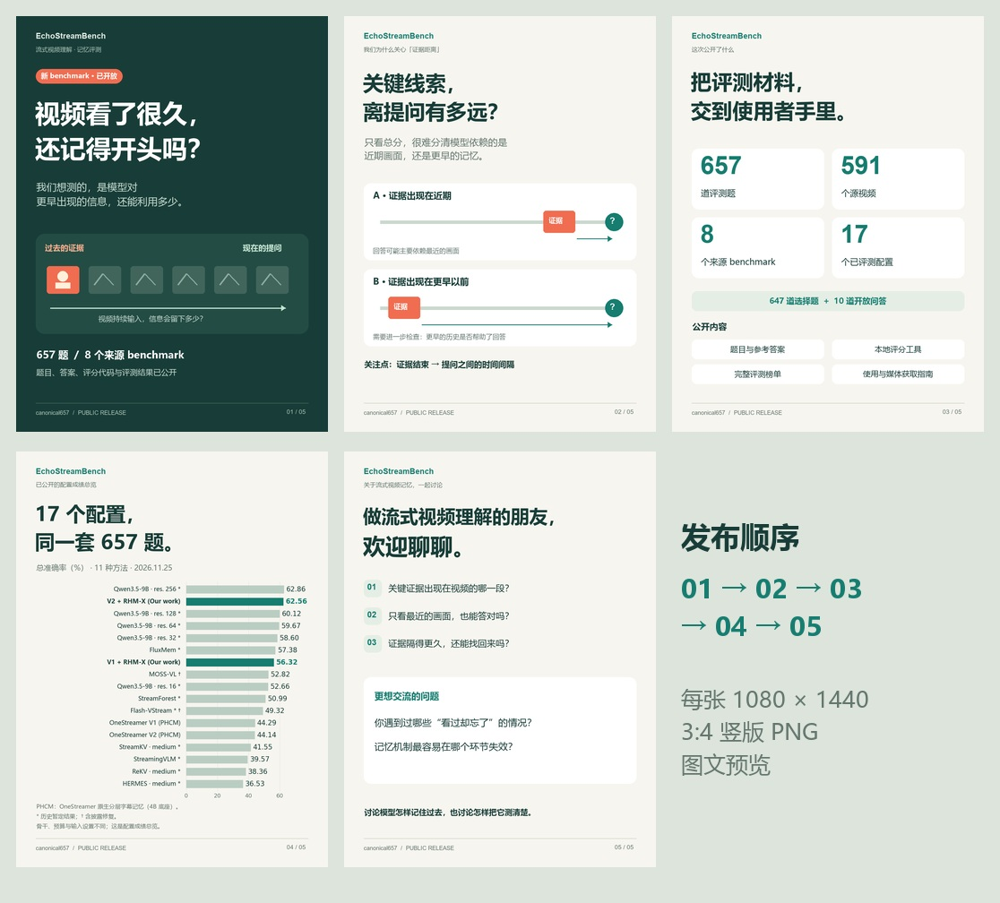

# EchoStreamBench sharing kit / 图文分享包

Five portrait images (1080 × 1440), a Chinese post, and a ZIP containing the images and copy. QR codes, external URLs, and off-platform contact instructions have been removed from the images and post. This kit does not imply platform approval.

[GitHub](https://github.com/tianyixian/EchoStreamBench) · [Hugging Face](https://huggingface.co/datasets/tianyixian/echostreambench-canonical657) · [Download ZIP / 下载图文包](EchoStreamBench-social-kit.zip) · [Chinese post / 中文文案](post.zh-CN.md)

| Order | Image |
|---|---|
| 01 | [Cover / 封面](01_cover.png) |
| 02 | [Evidence-distance diagram / 证据距离图](02_evidence_distance.png) |
| 03 | [Release facts / 公开数据规模](03_release_facts.png) |
| 04 | [Full configuration ranking / 完整配置榜单](04_full_ranking.png) |
| 05 | [Research discussion / 研究讨论](05_get_started.png) |

The ranking uses the published canonical657 results. OneStreamer V1/V2 (PHCM) denotes the native hierarchical caption-memory baseline; V1/V2 + RHM-X (Our work) denotes our RHM-X configuration. All four use the OneStreamer-4B backbone. The plot retains the provisional and repaired-result labels and does not imply equal-resource comparisons.

推荐按 01 → 02 → 03 → 04 → 05 发布。PHCM 指 OneStreamer 的原生分层字幕记忆；榜单突出 RHM-X，MOSS-VL 使用普通字重。最后一页为研究讨论。图片和文案已移除二维码、外链和站外联系指引；请勿继续使用旧版二维码素材。

The evidence-distance image shows two timing arrangements; it does not provide per-item evidence annotation. See the [full comparison notes](../../results/canonical657_comparison.md) and [Chinese design notes](design-notes.zh-CN.md) for scope.
